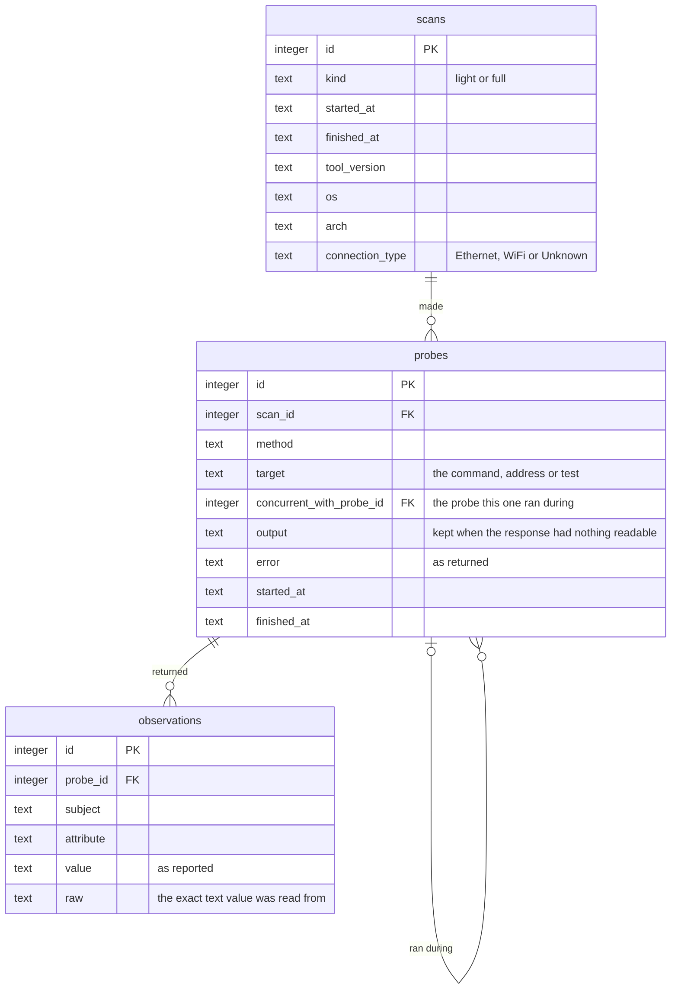

# big-apple-connect-box

An independent, open-source measurement box for home internet in New York
City.

Big Apple Connect is New York City's program that provides free home internet
to residents of NYCHA public housing. This project is building a small box,
and a matching app, that sits in a home and records how the internet
connection there performs: its speed, its delay and its reliability, kept as
evidence that anyone can check. The aim is for households, and the people who
run programs like Big Apple Connect, to be able to see what a connection
delivers.

> **This is an independent project.** It is not affiliated with, endorsed by
> or operated by the City of New York, NYCHA, or any internet provider. It
> carries the name of the program it was built to measure. We hope it will be
> useful to the city, and would welcome working with it.

## What this repository is

The collector: the program that runs on the box and collects evidence about a
home internet connection.

One Go program does the collecting. It runs on a dedicated box plugged into the
router, and as an app on a volunteer's own computer. Every scan records two
things together:

- **The setup:** what the connection is. Cable or Wi-Fi, the router and modem,
  the provider.
- **The measurements:** how the connection performs. These follow
  [Netrics](https://github.com/internet-innovation/netrics), the open-source
  software used in the University of Chicago's home broadband study.

The program records what it did and what came back, and stores it in a local
SQLite database, `evidence.db`, in the directory it is run from.

## Install

Each [release](https://github.com/malewis5/big-apple-connect-box/releases) has the
program for Raspberry Pi and other 64-bit ARM Linux (`linux_arm64`), Linux
(`linux_amd64`), Windows (`windows_amd64`) and macOS (`darwin_arm64`,
`darwin_amd64`), with a `checksums.txt` of their SHA-256 sums. To check a
download against it:

```sh
sha256sum --check --ignore-missing checksums.txt
```

With Go installed:

```sh
go install github.com/malewis5/big-apple-connect-box/cmd/big-apple-connect-box@latest
```

`big-apple-connect-box -version` prints the version the program was built from.

Releases published while the repository is public carry a build attestation:
a signed record, kept by GitHub, that the file was built by this repository's
release workflow from a specific commit. To verify a download with the
[GitHub CLI](https://cli.github.com):

```sh
gh attestation verify big-apple-connect-box_linux_arm64 --repo malewis5/big-apple-connect-box
```

## Run

From a checkout:

```sh
go run ./cmd/big-apple-connect-box                # one full scan, printed and saved
go run ./cmd/big-apple-connect-box -kind light    # one light scan
go run ./cmd/big-apple-connect-box -daemon        # keep running: light every 5 minutes, full every hour
go test ./...
```

Build for each system from any one machine:

```sh
CGO_ENABLED=0 GOOS=linux   GOARCH=arm64 go build -o dist/big-apple-connect-box-linux-arm64       ./cmd/big-apple-connect-box   # the box
CGO_ENABLED=0 GOOS=windows GOARCH=amd64 go build -o dist/big-apple-connect-box-windows-amd64.exe ./cmd/big-apple-connect-box
CGO_ENABLED=0 GOOS=darwin  GOARCH=arm64 go build -o dist/big-apple-connect-box-darwin-arm64      ./cmd/big-apple-connect-box
```

## What a scan does

| Step | Light (every 5 min) | Full (hourly) |
|---|---|---|
| Connection: interface, cable or Wi-Fi, wired link speed | Yes | Yes |
| Provider: public address and who it is registered to | | Yes |
| Router and modem: maker, model, serial, as they report it | | Yes |
| Route out, and the provider's first stop | Yes | Yes |
| Ping: router, provider's first stop, three internet points | Yes | Yes |
| Name lookup times | Yes | Yes |
| NDT7 speed test, with router pings and processor load during it | | Yes |
| Wi-Fi radio details, read after the measurements | Yes | Yes |

The schedule, ping settings, last-mile rule, name-lookup server and NDT7 speed
test are Netrics'.

| Measurement | Method |
|---|---|
| Ping | 10 pings with the system's `ping`, a quarter second apart on macOS and Linux and a second apart on Windows |
| Last mile | Trace the route to `1.1.1.1`, then ping the first stop outside the home network |
| Name lookup | Time one lookup of each of five site names against `8.8.8.8` |
| Hops | Count the stops to `1.1.1.1` |
| Speed | NDT7 download and upload against an M-Lab server |

The program adds one measurement to Netrics' set: it pings the router, idle and
during each phase of the speed test.

## Layout

```
cmd/big-apple-connect-box/    the command: flags, schedule, printed report
internal/collector/       the scan
    collector.go              scan, probe and observation types; scan order
    recorder.go               recording probes; running commands and reading files
    platform.go               what each operating system must provide
    darwin.go                 macOS commands and readers
    linux.go                  Linux commands and readers
    windows.go                Windows commands and readers
    setup.go                  provider, router and modem
    measure.go                route, ping, name lookup, speed test
internal/store/           the SQLite schema and saving a scan
```

Each step has two halves. One runs a command or makes a request. The other is
a function from the text that came back to observations. The second half is
what the tests cover, using sample output from macOS, Linux and Windows.

## Database



- A **scan** is one run.
- A **probe** is one thing the program did: a command run, a page requested, a
  test performed. Every probe has a row with its start time, finish time and
  any error returned. A probe can hold both observations and an error, as when
  a router sends its whole page and then leaves the response open.
- An **observation** is one fact read from a probe's response.

A router ping taken during the speed test points at the speed-test probe
through `concurrent_with_probe_id`.

Every observation `value` and `raw`, and every probe `output` and `error`, is
what the operating system, the network or the equipment returned. Three values
are produced by the program:

- `scans.connection_type` is the program's translation of the operating
  system's own word, which is stored beside it as the `interface_type`
  observation. The database accepts `Ethernet`, `WiFi` and `Unknown`.
- Name-lookup times are timed by the program. Their `raw` is empty.
- Speed-test results are computed from counters the test reports, the same way
  M-Lab's own client computes them. Their `raw` holds those counters.

### Subjects and attributes

| Subject | Meaning | Attributes |
|---|---|---|
| `host` | This computer's connection to the router | `interface_name`, `interface_type`, `link_speed`, `wifi_phy_mode`, `wifi_channel`, `wifi_signal`, `wifi_noise`, `wifi_tx_rate`, `cpu_load` |
| `wan` | The line's public side | `public_ip`, `asn`, `as_name`, `ptr_record` |
| `gateway` | The router | `ip_address`, `mac_address`, `oui_organization`, `ptr_record`, `http_status`, `manufacturer`, `model_name`, `model_number`, `serial_number`, ping results |
| `modem` | The modem | `http_status`, `manufacturer`, `model_name`, `model_number`, `serial_number` |
| `path` | The route out | `hop_1_ip_address`, `hop_2_ip_address`, `hop_3_ip_address`, `hops_to_target` |
| `last_mile` | The provider's first stop | `ip_address`, ping results |
| `internet` | Points beyond it | ping results, `dns_query_time_ms`, NDT7 results |

Ping results are `packets_transmitted`, `packets_received`, `packet_loss_pct`,
`rtt_min_ms`, `rtt_avg_ms`, `rtt_max_ms` and `rtt_mdev_ms`, named as in Netrics.

NDT7 results are `speedtest_ndt7_download`, `speedtest_ndt7_upload`,
`speedtest_ndt7_downloadretrans`, `speedtest_ndt7_downloadlatency`,
`speedtest_ndt7_uploadlatency`, `speedtest_ndt7_server`,
`speedtest_ndt7_downloaduuid` and `speedtest_ndt7_uploaduuid`. Speeds are in
Mbit/s, latencies in ms, and retransmission in percent. The two identifiers
are M-Lab's own, under which it publishes its record of the test.

Speed-test names follow Netrics' `speedtest_ndt7_*`.

Where a command prints more than is needed, the program keeps the needed parts.
From a device's pages it keeps the labelled maker, model and serial rows.

## Outside services

| Service | Used for | What it receives |
|---|---|---|
| M-Lab (NDT7) | Speed test | A speed test from this connection. M-Lab publishes its test records, including the public address. |
| ipinfo.io | Provider and public address | A request from this connection |
| api.macvendors.com | Router's manufacturer | The first three octets of the router's hardware address |
| 8.8.8.8 | Name-lookup timing | Lookups of five well-known site names |
| 1.1.1.1, 8.8.8.8, www.google.com | Ping and route trace | Pings |

Outside packages: `modernc.org/sqlite`, a pure-Go SQLite driver, and
`github.com/m-lab/ndt7-client-go`, M-Lab's NDT7 client.

## Status

- Run on macOS 27 (Apple silicon), on Wi-Fi, as an ordinary user, against one
  router (ARRIS NVG589).
- Run on Ubuntu 26.04 (x86_64) in a cloud machine, on a wired virtual
  interface, as an ordinary user: light and full scans.
- Releases are built for `linux/arm64`, `linux/amd64`, `windows/amd64`,
  `darwin/arm64` and `darwin/amd64`.
- The tests run on Linux, macOS and Windows on every push.
- The readers for route, connection, Wi-Fi, neighbor table, route trace, ping,
  device pages and speed-test counters are tested against sample output from
  macOS, Linux and Windows. Windows output is matched in English.
- On macOS 27 the lookup of the router's hardware address returns `no entry`,
  and the scan records that response.

## Releases

Versions and their changes are listed in [CHANGELOG.md](CHANGELOG.md), which
[release-please](https://github.com/googleapis/release-please) writes from the
commit history. Commit messages follow
[Conventional Commits](https://www.conventionalcommits.org): `fix:` for a
fix, `feat:` for a new capability, and a `!` after the type for a breaking
change.

On every push to `main`, release-please opens or updates a release pull
request with the next version and its changelog. Merging it tags the version
and publishes the release, and a workflow builds the program for each system
from that tag, attaches the files and attests the build.

## License

[0BSD](LICENSE). Use, copy, change and distribute it for any purpose, with or
without credit.
