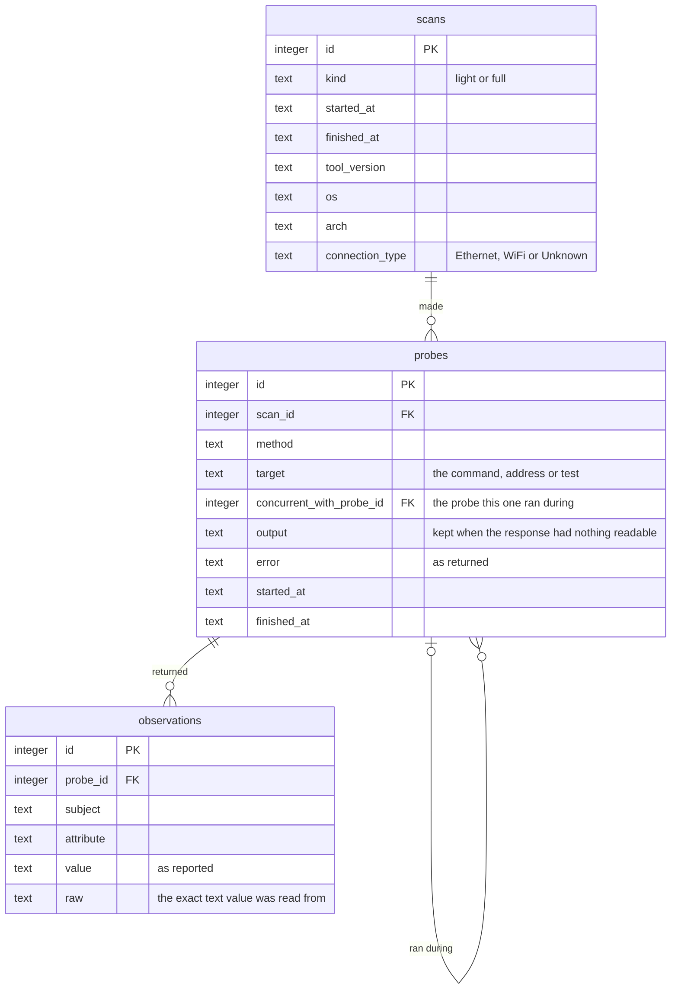

# The measuring program

This is the program that measures a home connection. It runs the same way on
the box and on a computer you already have. For what the project is aiming
for and how to download the program, start with the
[main README](../../README.md).

- [Usage](#usage)
- [What a scan records](#what-a-scan-records)
- [Common problems](#common-problems)
- [Verify a download](#verify-a-download)
- [How it measures](#how-it-measures)
- [The database](#the-database)
- [Outside services](#outside-services)
- [Build from source](#build-from-source)
- [Releases](#releases)
- [Tested on](#tested-on)

## Usage

```sh
./big-apple-connect-box               # one full scan
./big-apple-connect-box -kind light   # one light scan, about 10 seconds
./big-apple-connect-box -daemon       # keep running: light every 5 minutes, full every hour
./big-apple-connect-box -version      # print the version
```

## What a scan records

Every scan records two things together:

- **The setup:** what the connection is. Cable or Wi-Fi, the router and modem,
  the provider.
- **The measurements:** how the connection performs.

| Step | Light | Full |
|---|---|---|
| Connection: cable or Wi-Fi, link speed | Yes | Yes |
| Route out, and the provider's first stop | Yes | Yes |
| Ping: router, provider's first stop, three internet points | Yes | Yes |
| Name lookup times | Yes | Yes |
| Wi-Fi signal, channel and rate | Yes | Yes |
| Provider: public address and who it is registered to | | Yes |
| Router and modem: maker, model, serial number | | Yes |
| Speed test, with router pings and processor load during it | | Yes |

## Common problems

**macOS or Windows warns that the program is from an unknown developer.**
The program is not code-signed, and both systems warn about unsigned programs
downloaded with a browser. The commands in the
[main README](../../README.md#quick-start) download without a browser, which avoids
the warning. If you used a browser:

- macOS: run `xattr -d com.apple.quarantine ./big-apple-connect-box`
- Windows: choose **More info**, then **Run anyway**

To confirm the file is genuine first, see [Verify a download](#verify-a-download).

**The route trace fails on Linux with `"traceroute": executable file not found`.**
Install it, then scan again:

```sh
sudo apt install traceroute
```

**The router's hardware address is missing on macOS.**
macOS returns `no entry` for it to programs Apple did not sign. The scan
records that response and continues.

Found something else? [Open an issue](https://github.com/malewis5/big-apple-connect-box/issues).

## Verify a download

Each [release](https://github.com/malewis5/big-apple-connect-box/releases)
includes `checksums.txt`, the SHA-256 sum of every file. Download it and look
up the program's sum in it:

```sh
curl -L -O https://github.com/malewis5/big-apple-connect-box/releases/latest/download/checksums.txt
grep "$(shasum -a 256 big-apple-connect-box | cut -d' ' -f1)" checksums.txt
```

A genuine file prints its line from `checksums.txt`. On Windows, compare the
output of `Get-FileHash big-apple-connect-box.exe` with the file by eye.

Each file also has a build attestation: a signed record, kept by GitHub, that
it was built by this repository's release workflow from a specific commit.
Check it with the [GitHub CLI](https://cli.github.com):

```sh
gh attestation verify big-apple-connect-box --repo malewis5/big-apple-connect-box
```

## How it measures

The measurements follow
[Netrics](https://github.com/internet-innovation/netrics), the open-source
software used in the University of Chicago's home broadband study. The
schedule, settings and result names match, so results can be compared.

| Measurement | Method |
|---|---|
| Ping | 10 pings with the system's `ping`, a quarter second apart on macOS and Linux and a second apart on Windows |
| Last mile | Trace the route to `1.1.1.1`, then ping the first stop outside the home network |
| Name lookup | Time one lookup of each of five site names against `8.8.8.8` |
| Hops | Count the stops to `1.1.1.1` |
| Speed | NDT7, M-Lab's open speed test: download, then upload |

One measurement is added to Netrics' set: the router is pinged too, both idle
and during each half of the speed test.

## The database

`evidence.db` is a [SQLite](https://sqlite.org) file with three tables.

- A **scan** is one run.
- A **probe** is one thing the program did: a command run, a page requested, a
  test performed. Every probe has a row with its start time, finish time and
  any error returned.
- An **observation** is one fact read from a probe's response.



**Stored values are what was returned.** Every observation `value` and `raw`,
and every probe `output` and `error`, is what the operating system, the network
or the equipment sent back. Three values are produced by the program:

- `scans.connection_type` is the program's translation of the operating
  system's own word, which is stored beside it as the `interface_type`
  observation.
- Name-lookup times are timed by the program. Their `raw` is empty.
- Speed-test results are computed from counters the test reports, the same way
  M-Lab's own client computes them. Their `raw` holds those counters.

A probe can hold both observations and an error, as when a router sends its
whole page and then leaves the response open. A router ping taken during the
speed test points at the speed-test probe through `concurrent_with_probe_id`.

### Subjects and attributes

| Subject | Meaning | Attributes |
|---|---|---|
| `host` | This computer's connection to the router | `interface_name`, `interface_type`, `link_speed`, `wifi_phy_mode`, `wifi_channel`, `wifi_signal`, `wifi_noise`, `wifi_tx_rate`, `cpu_load` |
| `wan` | The line's public side | `public_ip`, `asn`, `as_name`, `ptr_record` |
| `gateway` | The router | `ip_address`, `mac_address`, `oui_organization`, `ptr_record`, `http_status`, `manufacturer`, `model_name`, `model_number`, `serial_number`, ping results |
| `modem` | The modem | `http_status`, `manufacturer`, `model_name`, `model_number`, `serial_number` |
| `path` | The route out | `hop_1_ip_address`, `hop_2_ip_address`, `hop_3_ip_address`, `hops_to_target` |
| `last_mile` | The provider's first stop | `ip_address`, ping results |
| `internet` | Points beyond it | ping results, `dns_query_time_ms`, speed-test results |

- **Ping results:** `packets_transmitted`, `packets_received`,
  `packet_loss_pct`, `rtt_min_ms`, `rtt_avg_ms`, `rtt_max_ms`, `rtt_mdev_ms`.
- **Speed-test results:** `speedtest_ndt7_download` and `speedtest_ndt7_upload`
  in Mbit/s, `speedtest_ndt7_downloadlatency` and
  `speedtest_ndt7_uploadlatency` in ms, `speedtest_ndt7_downloadretrans` in
  percent, `speedtest_ndt7_server`, and `speedtest_ndt7_downloaduuid` and
  `speedtest_ndt7_uploaduuid`, M-Lab's own identifiers for the test.

Where a command prints more than is needed, the program keeps the needed parts.
From a device's pages it keeps the labelled maker, model and serial rows.

## Outside services

| Service | Used for | What it receives |
|---|---|---|
| M-Lab (NDT7) | Speed test | A speed test from this connection. M-Lab publishes its test records, including the public address. |
| ipinfo.io | Provider and public address | A request from this connection |
| api.macvendors.com | Router's manufacturer | The first three octets of the router's hardware address |
| 8.8.8.8 | Name-lookup timing | Lookups of five well-known site names |
| 1.1.1.1, 8.8.8.8, www.google.com | Ping and route trace | Pings |

## Build from source

To install only the program, with [Go](https://go.dev):

```sh
go install github.com/malewis5/big-apple-connect-box/apps/box/cmd/big-apple-connect-box@latest
```

To run a scan from a checkout:

```sh
cd apps/box && go run ./cmd/big-apple-connect-box
```

The program is laid out like this:

```
apps/box/
    cmd/big-apple-connect-box/    the command: flags, schedule, printed report
    internal/collector/           the scan
        collector.go                  scan, probe and observation types; scan order
        recorder.go                   recording probes; running commands and reading files
        platform.go                   what each operating system must provide
        darwin.go                     macOS commands and readers
        linux.go                      Linux commands and readers
        windows.go                    Windows commands and readers
        setup.go                      provider, router and modem
        measure.go                    route, ping, name lookup, speed test
    internal/store/               the SQLite schema and saving a scan
```

Each step has two halves. One runs a command or makes a request. The other is
a function from the text that came back to observations. The tests cover the
second half, using sample output from macOS, Linux and Windows.

It uses two outside packages: [`modernc.org/sqlite`](https://modernc.org/sqlite),
a SQLite driver written in Go, and
[`ndt7-client-go`](https://github.com/m-lab/ndt7-client-go), M-Lab's speed-test
client.

## Releases

Every version and its changes are in [CHANGELOG.md](../../CHANGELOG.md).

[release-please](https://github.com/googleapis/release-please) writes the
changelog from commit messages, which follow
[Conventional Commits](https://www.conventionalcommits.org): `fix:` for a fix,
`feat:` for a new capability, and a `!` after the type for a breaking change.

On every push to `main`, release-please updates a release pull request with
the next version. Merging it tags the version and publishes the release. A
workflow then builds the program for each system from that tag, attaches the
files and attests the build.

Every release also carries `LICENSE`, `NOTICE` and `THIRD_PARTY_NOTICES.txt`.
The last holds the license of everything compiled into the program: Go's
standard library and each outside module. It is made from the programs
themselves by [`scripts/third-party-notices.sh`](scripts/third-party-notices.sh),
so it can't fall behind a dependency change.

## Tested on

- **macOS:** run on macOS 27 (Apple silicon), on Wi-Fi, as an ordinary user,
  against one router (ARRIS NVG589).
- **Linux:** run on Ubuntu 26.04 (x86_64) in a cloud machine, on a wired
  virtual interface, as an ordinary user.
- **Windows:** the tests run there. Output is matched in English.
- **Tests:** run on Linux, macOS and Windows on every push.
- **Releases:** built for `linux/arm64`, `linux/amd64`, `windows/amd64`,
  `darwin/arm64` and `darwin/amd64`.
